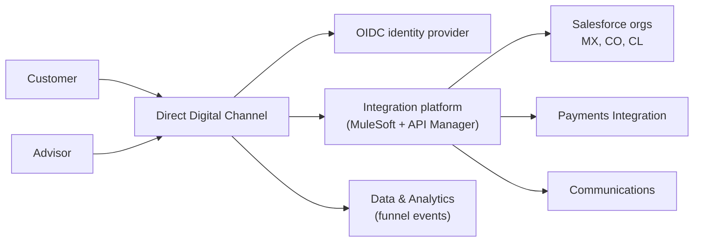
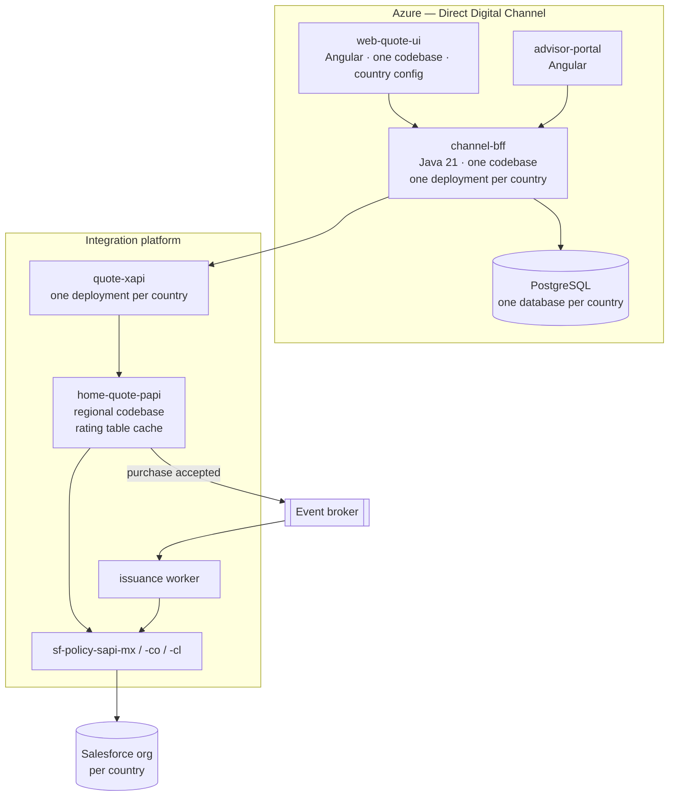

# Target architecture — Direct Digital Channel

## 1. Goals

The target architecture must let us build Home Essentials (BR-01) once and serve it in Mexico, Colombia and Chile, and progressively move the existing journeys to the same components. The main drivers are C1 (one country must not affect the others, as happened in INC-0907), C2 (2.5 s p95 at month-end), C3 (reuse without forks) and C6 (Salesforce limits).

## 2. Context (C4 level 1)

## 3. Containers (C4 level 2)

## 4. Regional or country-specific

| Capability | Built once (regional) | Country-specific | How the variation is handled |
|---|---|---|---|
| Quote and purchase screens | `web-quote-ui` codebase | Texts, consents, mandatory fields, documents | Country configuration file loaded at runtime; no forks |
| Advisor portal | `advisor-portal` | Countries the advisor can serve | Configuration |
| BFF | `channel-bff` codebase | One deployment per country with its own configuration | `CountryProperties` (already in the codebase) |
| Experience API | `quote-xapi` codebase | One deployment per country | Environment properties |
| Process API | `home-quote-papi` codebase | Taxes, mandatory coverages | Product rules in each Salesforce org plus country properties |
| System APIs | — | One per org | Owned by the Salesforce platform team |
| Channel data (quote drafts) | Schema | One PostgreSQL database per country | Same migrations, applied per country |

**Rule:** no country-specific code in shared components. When a variation cannot be expressed as configuration or as a product rule, it goes to a design review with the Technical Lead before any code is written.

## 5. Integration with Salesforce

**Path.** `channel-bff` → `quote-xapi` (country deployment) → `home-quote-papi` → `sf-policy-sapi-<country>` → org. No component of the channel calls Salesforce directly (C4).

**Rating tables.** `home-quote-papi` caches the six rating tables in memory per country and refreshes them daily at 05:30 UTC, after the 05:00 publication. Every quote stores and returns `ratingTableVersion`, as the business requires (`SALESFORCE_CONSTRAINTS.md`).

**Budget check (C6).** With the cache, a quote needs one rating call and occasionally a product lookup, so ≈ 1.3 calls per quote, as in `sf-api-usage-daily.csv` before 29 September.

| Org | Month-end quotes per day (from `sf-api-usage-daily.csv`) | Calls at 1.3 | Budget | Peak rate (3× MX, 2× CO and CL) |
|---|---|---|---|---|
| MX | ≈ 158,000 | ≈ 205,000 | 250,000 | ≈ 1,900 quotes / 5 min → ≈ 8 req/s |
| CO | ≈ 139,000 | ≈ 181,000 | 300,000 | ≈ 6 req/s |
| CL | ≈ 61,000 | ≈ 80,000 | 150,000 | ≈ 3 req/s |

All countries stay below the 40 req/s guidance. Mexico uses 82% of its budget at month-end, so we must agree a higher budget before Home Essentials grows. Home Essentials itself adds ≈ 500 quotes per day per country, which is negligible.

**Issuance.** Purchase is accepted by `home-quote-papi`, which publishes an event; the issuance worker issues the policy through the System API with retries and exponential backoff. If Salesforce is unavailable, events wait in the broker and the customer is notified through Communications when the policy is issued. The quote ID is the idempotency key.

**Resilience defaults.**
- Timeouts: 2 s per hop on the quote path.
- A circuit breaker for each downstream API.
- Retries: at most one, with exponential backoff and jitter, and only for idempotent reads.
- `quote-xapi` and `channel-bff` are deployed per country, so a slow country cannot consume the capacity of the others (the root cause of INC-0907).

**Availability.** With the rating tables cached and the per-country isolation, the quote journey can reach the 99.5% target even though each org has about 97% availability.

## 6. Identity and data protection

- Customers log in with OIDC. `channel-bff` validates the JWT (issuer, audience and signature) and takes the customer from `sub`.
- The country is selected by the customer in the frontend and sent in the request; `channel-bff` checks that it is one of MX, CO or CL.
- Personal data stays in the Salesforce org of each country, so it is separated by design.
- No personal data in logs: only quote ID, country and correlation ID.
- Secrets in Key Vault, accessed with managed identities.

## 7. Transition from the current state

1. **Q1, first weeks:** actions from INC-0907 — restore the cache in `quote-papi-mx`, deploy `quote-xapi` per country, route Mexican issuance through `sf-policy-sapi-mx` (TD-02).
2. **Q1–Q2:** Home Essentials built on `web-quote-ui`, `channel-bff` and `home-quote-papi` from day one, including Mexico. This is the first Mexican journey on the shared stack.
3. **H2 2027:** move the existing Mexican auto journeys out of `mx-quote-bff` one by one, then retire it. Consolidate the quote Process APIs as each product moves (TD-01).

No big-bang: each step is a journey or a product, and the old path stays until the new one is stable.

## 8. Guidelines and standards

- Follow REST best practices; resource names in plural.
- Version all APIs.
- Use camelCase for JSON fields.
- Handle errors in a consistent way.
- Always configure timeouts on outbound calls.
- Prefer configuration over code for country differences.
- Reuse existing components before creating new ones.
